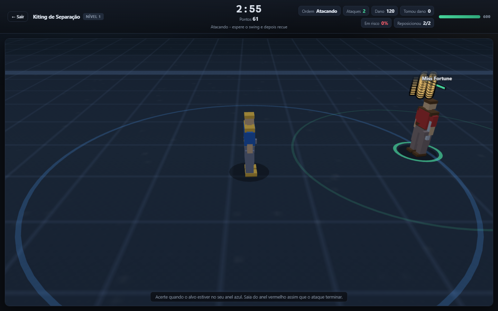

# SkillGap Web — Treino de Kiting e Esquiva no navegador

Uma versão para navegador de um *aim trainer* de League of Legends, focada em
**kiting** (separação/posicionamento durante o ataque) e **esquiva**
(skillshots). Roda 100% offline depois do primeiro download, sem build step e
sem dependências de runtime.



---

## Como rodar

**Windows:** dê duplo clique em `start.bat` (abre o navegador automaticamente).

**Linha de comando:**

```bash
node server.mjs          # http://localhost:5173
# ou
npm start
```

> Por que um servidor? O app usa ES modules nativos. O navegador bloqueia
> `import` via `file://` (política de origem cruzada), então o `index.html`
> precisa ser servido por `http://localhost`.

---

## Controles — igual ao League of Legends

A movimentação é por **clique direito**, como no jogo. Não existe WASD.

| Entrada | Ação |
|---|---|
| **Botão direito no chão** | Anda até o ponto. Clicar de novo durante o caminho troca o destino. |
| **Botão direito no inimigo** | Ataca o alvo: o campeão se aproxima e auto-ataca enquanto ele estiver ao alcance. |
| **Botão esquerdo no inimigo** | Também ataca (atalho; no LoL puro o esquerdo apenas seleciona). |
| **`A` (segurar)** | Mostra o alcance de auto-ataque. Enquanto seguro, clique direito no chão = attack-move; clique direito em inimigo = foca no alvo mais próximo (configurável no admin). Soltar `A` cancela. |
| **`S`** | Para a ação atual. |
| **`Q` `W` `E` `R`** | Habilidades, mirando com o mouse. |
| **`Y`** | Alterna câmera travada no personagem / solta (borda da tela move a câmera). |
| **Mouse** | Mira e mostra a marcação de perigo. |
| **`Esc`** | Sai do treino. |

A ordem é **persistente**: ela só muda quando você dá outra ordem. É
exatamente por isso que o kiting funciona como funciona no jogo —

> 1. clique com o botão direito no inimigo para atacar
> 2. quando o ataque sair, clique com o botão direito no chão para se afastar
> 3. quando a recarga acabar, ataque de novo
> 4. repita

> **Durante o treino o menu de contexto do navegador fica bloqueado** (o botão
> direito é um comando de jogo), inclusive no HUD. No menu principal ele volta
> a funcionar normalmente.

O HUD mostra a **ordem atual** ("Atacando" / "Movendo" / "Parado") e uma
dica ao vivo do que fazer em seguida.

---

## Admin — mapa, campeões, inimigos e treinos

O botão **Admin** no topo do menu abre a tela de configuração. Cada mudança é
salva em `localStorage` e aplicada ao jogo sem reiniciar (o próximo treino já
usa os valores novos).

| Aba | O que controla |
|---|---|
| **Mapa** | Largura e altura da arena (1.200–9.000 × 900–7.000 unidades), zoom, FOV, altura e distância da câmera, e os anéis de alcance. |
| **Campeões** | Vida, dano, alcance, velocidade de ataque, windup (ms), velocidade de movimento, velocidade do projétil, armadura e tipo de ataque — por campeão. |
| **Inimigos** | Multiplicadores globais de alcance, velocidade, dano e vida dos inimigos; vida, raio de acerto e **velocidade de ataque** do jogador; **câmera travada/solta** e **A + clique direito foca no alvo mais próximo**. |
| **Treinos** | Duração, número de inimigos, vida do jogador, espaçamento (kiting), velocidade do projétil, intervalo entre lançamentos e raio de spawn (esquiva). |
| **Dados REA** | Navega as 48 chaves e os 382 níveis recuperados do Firestore, edita qualquer campo numérico ou o JSON completo do nível e restaura o valor original. |

Regras que valem para todos os campos:

- **Campo vazio = valor padrão.** O número em cinza dentro do campo é o padrão
  daquele nível/campeão; o botão **↺** restaura apenas aquele campo.
- O mapa padrão passou de 2.400 × 1.400 para **3.200 × 1.900** unidades.
- O multiplicador de **alcance inimigo** começa em `1,00` (o alcance real do
  campeão). `1,40` deixa o anel vermelho 40% maior — é a alavanca para treinar
  contra inimigos que te superam em alcance.
- **Exportar JSON** baixa a configuração atual; **Importar JSON** aplica um
  arquivo (dá para versionar presets ou levar de um navegador para outro).
- **Restaurar padrões** zera só a configuração. O progresso dos treinos fica em
  outra chave do `localStorage` e não é afetado.

---

## Os treinos

| Treino | Categoria | O que treina |
|---|---|---|
| **Kiting de Separação** | Kiting | O ritmo ataque → recuo → ataque contra um parceiro com o **mesmo alcance que o seu**. Você sempre consegue atacar; a questão é levar o contra-ataque. |
| **Kiting Defensivo** | Kiting | Inimigos que perseguem, atiram e conjuram. Manter a distância máxima sem perder o DPS. |
| **Peel / Proteção** | Kiting | Kitar os inimigos para longe do seu parceiro com vida baixa. |
| **Esquiva de Skillshots** | Esquiva | Campeões reais disparando as skillshots deles — tempo de cast, velocidade de projétil e largura de hitbox originais. |
| **Esquiva e Contragolpe** | Esquiva | Além de sobreviver: 3 segundos para punir o inimigo depois de cada esquiva. |
| **Kiting — Microgame (REA)** | Kiting | O `KITING_0` real: vida, AD, velocidade e velocidade de ataque do jogador e do inimigo vêm do Firestore. |
| **Kiting + Esquiva (REA)** | Kiting | O `KITING_DODGE` real: um perseguidor com stats reais e tempo de cast recuperado lança skillshots enquanto você kita. |

Os cinco treinos originais usam os níveis reais de `AUTO_SPACING`,
`DEFENSIVE_KITING`, `PEELING_MICROGAME`, `SKILL_DODGE` e `SHOOT_DODGE` quando o
snapshot está disponível. Cada um tem 10 níveis; o nível libera o seguinte com
70–75 pontos. Os dois treinos marcados **REA** foram anexados ao fim do menu
para não deslocar os IDs e os índices usados pelo `probe.mjs`.

> **Sobre `trainingDuration`:** os documentos usam `60` para warmups e `3/4/5`
> para microgames. O web trainer interpreta `<= 10` como minutos (3 → 180 s),
> porque é o padrão que bate com a duração dos microgames, mas o módulo
> `TimerTModule` do jogo consome o campo cru como segundos quando o brain system
> está ativo. O valor cru e o `durationSeconds` calculado ficam visíveis e
> editáveis na aba **Dados REA**.

### Como a pontuação é calculada

**Kiting** — três eixos, como no microgame do Skill Gap:

- **DPS efetivo (40%)** — dano causado ÷ dano máximo teórico. Mede o quanto
  você exploitou a janela de ataque.
- **Segurança (35%)** — fração do treino fora do alcance de ameaça inimigo.
- **Ritmo de ataque (25%)** — precisão das investidas + quantas vezes você
  reposicionou para fora do alcance depois de atacar.

**Esquiva:**

- **Taxa de esquiva (75%)** — esquivas ÷ (esquivas + lançamentos).
- **Tempo de reação (25%)** — média do tempo entre a marcação aparecer e você
  sair da área de perigo (0,12 s = excelente, 0,45 s = fraco).

---

## O 3D

A cena é Three.js (vendorizado em `vendor/three.module.js`, sem CDN e sem
internet em tempo de execução).

- **Câmera** em perspectiva inclinada, seguindo o campeão com amortecimento e
  presa às bordas da arena — o enquadramento clássico de lane.
- **Campeões** são modelos low-poly gerados por código: humanóide estilizado
  com proporções de LoL (180 unidades de altura, raio de gameplay 65),
  paleta por campeirão e silhueta de arma própria (arma de fogo, arco, cajado,
  foice, martelo, lâmina…). Os rigs da Riot são proprietários, então os
  modelos aqui são originais.
- **Animação** procedural: ciclo de caminhada, curva de contra-ataque no
  windup, tombo ao morrer.
- **Indicadores** no chão: anel azul = seu alcance de ataque, anel vermelho
  tracejado = alcance de ameaça do inimigo (fica **verde** quando existe uma
  faixa onde você ataca sem ser atingido), anel verde = alvo atual.
- **Telegráficos de skillshot** desenhados no chão, com a marca de perigo
  aparecendo antes do projétil, e projétil 3D voando.
- **Barras de vida** e nome do alvo flutuando sobre o modelo.

> **Nota sobre a origem:** o `Skill Gap` instalado na máquina
> (`C:\Program Files (x86)\Skill Gap`) é um cliente **Unity 2021.3.23f1 Mono**
> do estúdio *United Gamers* (v4.5.5). A instalação original estava sem a pasta
> `SkillGap_Data`, então o `SetupUG.exe` foi instalado em uma pasta temporária
> (`%TEMP%\opencode\SkillGap-4.5.5`) **sem alterar a instalação original**. Dessa
> cópia foram recuperados:
>
> - `Assembly-CSharp.dll` — lógica dos managers, spawners e do loader do
>   Firestore (SHA-256 `D4164085356B3F20B474BE0F08D2608FAEEA6C759E04D7209793B1B8D427F84C`).
> - `resources.assets` / bundles — 48 `TrainingDefinitionSO`, prefabs de manager
>   e spawner, e os schemas de gameplay.
> - `Player.log` (em `%LOCALAPPDATA%\Low\UG\SkillGap\`) — arquitetura interna e
>   nomes dos módulos do brain.
> - `ChampionsData\ADC_1_Last.bin` — um `ChampionSO` serializado do Unity.
> - `eventcache` — eventos de analytics com nomes de treino e pontuação.
>
> Os **modelos 3D oficiais** continuam proprietários e não são extraídos; o 3D
> do trainer segue procedural. O que foi recuperado e reaproveitado são os
> dados de treino e a lógica de configuração.
>
> ### O que o log do jogo revelou (e o que foi reproduzido aqui)
>
> ```
> [UserEditableScanner] Module [0] = TimerTModule
> [UserEditableScanner] Module [1] = ObstacleTModule
> [UserEditableScanner] Module [2] = PlayerTModule
> [UserEditableScanner]   'PlayerTModule.setupStrategies' is List<SO> with 3 items.
> [UserEditableScanner]   [0] = PlayerStatsSetupStrategy
> [UserEditableScanner]   [1] = ImmortalSetupStrategy
> [UserEditableScanner]   [2] = HealthRegenSetupStrategy
> [UserEditableScanner] Module [3] = PointBasedProgressiveSpawner
> [HUD] Binding 'castMissed' to Dodges as EVENT/COUNTER.
> Loaded Firestore Level Config ID: 1
> ```
>
> Ou seja: o Skill Gap original é uma **microgame cena modular** — um "brain"
> composto por módulos (timer, obstáculos, setup do jogador, spawners
> progressivos por ponto, módulo de enganos) — com o nível lido do Firestore,
> HUD alimentado por eventos de gameplay e pontuação de 0 a 100.
>
> Este projeto mantém essa forma: cada treino é um conjunto de módulos
> (`Timer`, `Player`, `Spawner`, `Mistake`) e a pontuação é um número de 0 a
> 100 com três componentes visíveis. A lista de treinos do cliente original
> também apareceu no log (`DEFENSIVE_KITING`, `OFFENSIVE_KITING_MICROGAME`,
> `PEELING_MICROGAME`, `SKILL_DODGE`, `SHOOT_DODGE`, `KITING_DODGE`,
> `FARMING_SIMULATOR`, `LH`, `AIM_BOOSTER`, …) e foi usada como referência.
>
> O `ChampionSO` serializado do binário original tem exatamente o schema que o
> gerador de dados reproduz: `health`, `visionRange`, `speed`, `armor`,
> `magicResistance`, `attackDamage`, `attackRange`, `projectileSpeed`,
> `attackSpeed`, `windUpPercentage`, `isMelee`, `abilityPower`, `abilityHaste`.

### Dados de campeões

Os stats base dos campeões vêm de fontes públicas:

- **Meraki Analytics** — stats base (vida, AD, alcance, velocidade de ataque,
  **tempo de windup do auto-ataque**, velocidade de movimento), tempo de cast e
  velocidade de projétil de cada habilidade.
- **CommunityDragon** — alcance numérico autoritativo das habilidades e os
  retratos.

Os níveis reais do Skill Gap (vida/AD/velocidade/AS do jogador e do inimigo,
alcance do parceiro em `AUTO_SPACING`, contagem e velocidade dos perseguidores,
campeões e pesos de spawn) vêm do snapshot `src/data/skillgap-levels.json`,
gerado a partir do Firestore público do jogo. Quando o snapshot não carrega, os
treinos caem de volta nas tabelas antigas.

O `windUpPercentage` do `ChampionSO` virou o `attackCastTime` aqui: durante o
windup o campeão fica travado, que é exatamente o que faz do kiting um
problema de timing e não só de distância.

---

## Estrutura

```
skillgap-web/
├── index.html              shell da aplicação
├── styles.css
├── server.mjs              servidor estático sem dependências
├── start.bat               atalho Windows (Node ou Python)
├── vendor/three.module.js  Three.js 0.160.0 vendorizado (MIT)
├── assets/champions/       retratos (24 PNGs)
├── src/
│   ├── main.js             roteamento de telas, menu, HUD, resultados
│   ├── store.js            progressão em localStorage
│   ├── config.js           configuração do admin em localStorage
│   ├── admin.js            tela de configuração (mapa, campeões, inimigos, treinos, dados REA)
│   ├── core/               math, loop de passo fixo, input
│   ├── engine/             unit, skillshot, world, orders, scene3d, models
│   ├── drills/             kiting.js, dodging.js, skillgap.js, common.js
│   └── data/
│       ├── champions.json  dados gerados (24 campeões)
│       └── skillgap-levels.json  48 chaves / 382 níveis reais do Firestore
└── tools/
    ├── build-champions.py  gera src/data/champions.json
    ├── fetch-portraits.py  baixa os retratos
    └── probe.mjs           driver end-to-end via CDP
```

O loop de simulação roda em **passo fixo de 120 Hz** com renderização
interpolada, para que um monitor de 144 Hz não dê vantagem sobre um de 60 Hz.

---

## Ferramentas

```bash
# regerar os dados dos campeões (precisa de internet)
python tools/build-champions.py
python tools/fetch-portraits.py

# teste end-to-end: abre o Chrome headless, joga os treinos de verdade
# (clique direito inclusive) e salva screenshots em tools/.shots/
node tools/probe.mjs
```

O `probe.mjs` não é um mock: ele dirige o Chrome pelo Chrome DevTools Protocol,
**clica com o botão direito de verdade**, joga o bot de kiting (ataca →
espera o swing → recua com um novo comando) e o bot de esquiva (clica para o
lado seguro do projétil), abre a aba **Dados REA**, aplica um JSON e confere a
persistência, e falha se aparecer qualquer erro de console.

---

## Dados REA (Firestore)

O caminho exato lido pelo `PlayerDB` é:

```
TrainingsUG_Live/v4.4.0/Trainings/{trainingKey}/Training/{level}
```

O `v4.4.0` é **hardcoded no `Assembly-CSharp.dll`**, não é a versão do cliente.
O documento é público; não é necessário token de usuário para ler as configs.

Para atualizar o snapshot:

```bash
python ..\skillgap-re\fetch_firestore.py
python ..\skillgap-re\build_skillgap_data.py
```

O primeiro comando refaz o dump cru em `skillgap-re/dump/firestore/`; o segundo
gera `src/data/skillgap-levels.json` com os stats já parseados, o
`durationSeconds` calculado e o catálogo de campos por chave. O relatório
técnico completo está em `skillgap-re/RELATORIO.md`.

---

## Limitações conhecidas

- **Os modelos 3D são procedurais**, não os rigs oficiais da Riot. A silhueta e
  a paleta identificam o campeão, mas não é o modelo do jogo.
- **O hitbox do jogador é 45 unidades** por padrão, em vez dos 65 do radius de
  gameplay do League, para que uma esquiva comprometida conte em vez de parecer
  arbitrária. O valor é ajustável na aba **Inimigos** do Admin.
- **A velocidade do projétil é escalada por nível** nos níveis antigos (0,5× a
  0,85×). Nos níveis mapeados para dados REA, o formato, a largura e o tempo de
  cast continuam reais; a velocidade não é mais escalada pelo web trainer.
- As configurações de nível do Skill Gap **são públicas** em
  `TrainingsUG_Live/v4.4.0/Trainings/{key}/Training/{level}`. O snapshot local
  é uma cópia fiel desses documentos, com `Infinity`/`NaN` convertidos para
  `null`. A **interpretação para o motor web** (por exemplo, transformar
  `maxEntitiesAlive` em um número de casters e `spawnsPerSecond` em cooldown)
  ainda é uma aproximação: os managers originais são específicos de cada treino.
- Algumas chaves não têm documentos de nível: `AUDIO_REACTION`,
  `CUSTOM_TESTING`, `KEY_REACTION`, `LANING_MICROGAME`, `MOUSE_REACTION`,
  `SMITE_MICROGAME`, `TEST_FOR_FIRESTORE_SAVING` e `VISUAL_REACTION`.
  `COMPLEX_REACTION` e `MICROGAME_TESTING` têm apenas 1 nível.
- **`trainingDuration` não é uma unidade universal.** O `TimerTModule` do jogo
  usa o int cru como segundos, mas os microgames usam managers/rounds próprios;
  o web trainer adota a heurística `<= 10 → minutos` e expõe o valor cru e o
  calculado no admin.
- Não há áudio. É o item mais óbvio da lista de "faz depois".
# Kiting-versus
